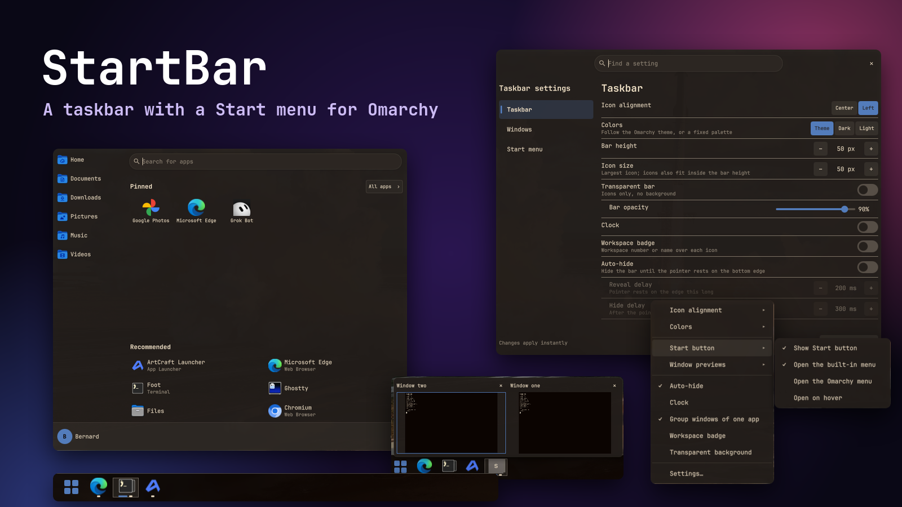
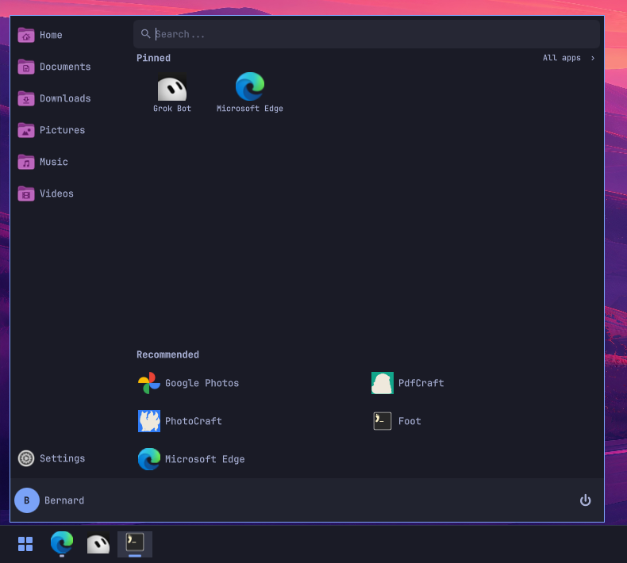
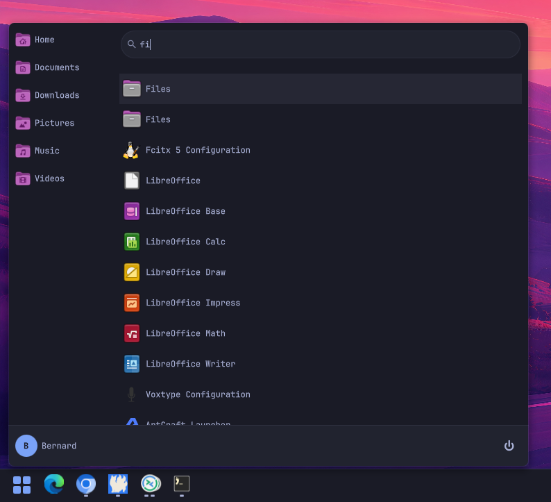
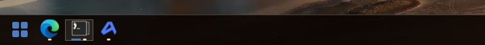
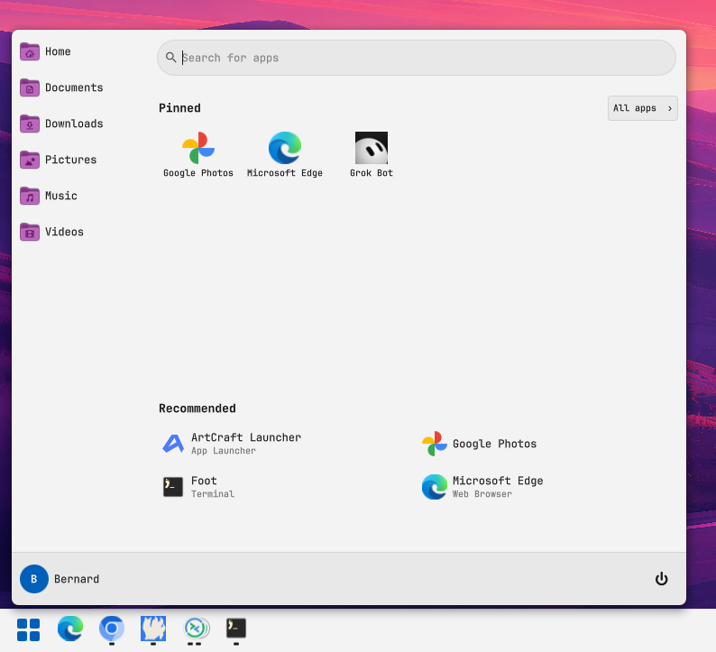
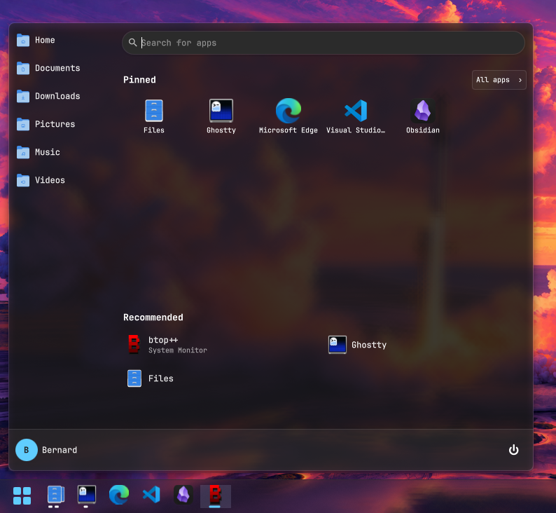
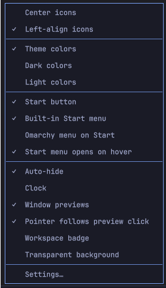
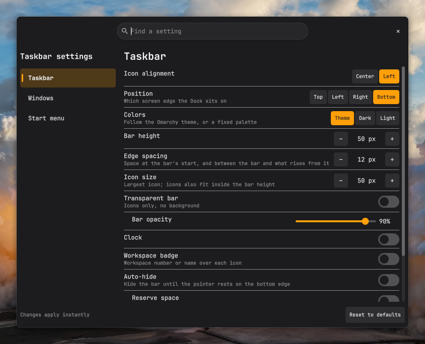

<p align="center">
  
</p>

<h1 align="center">StartBar</h1>

<p align="center">
  <b>A taskbar with a Start menu for Omarchy.</b><br>
  Every open window on every workspace and monitor, your pinned apps, and a Start menu
  with search, all a click away.
</p>

<p align="center">
  <a href="#install">Install</a> ·
  <a href="#features">Features</a> ·
  <a href="#configure">Configure</a> ·
  <a href="#update-and-remove">Update and remove</a> ·
  <a href="#contributing">Contributing</a>
</p>

## Install

```sh
omarchy plugin add https://github.com/bmaltais/StartBar --enable
```

It shows a taskbar at the bottom of every monitor. Everything it needs comes with Omarchy; there is nothing else to install. The Start button opens the Omarchy menu by default; to use StartBar's own Start menu, shown below, right-click the bar and choose **Built-in Start menu**.

## Features

| | |
|---|---|
| **Every window** | One icon per open window, across all workspaces and monitors. Click to jump to it. |
| **Pins** | Keep apps in the bar whether or not they are running. Drag to reorder, drag out to unpin. |
| **Start menu** | Search every installed app, a Pinned grid, an A-Z list, recently launched apps, your folders, and lock, sign out and power. |
| **Hover previews** | Live window thumbnails with a close button. |
| **Right-click menus** | The app's own actions, plus Maximize, Full screen, Float, Move to scratchpad and Close. |
| **Follows your theme** | Colours and fonts track the current Omarchy theme live, or pick a fixed light or dark bar. |

<table>
  <tr>
    <th>Start menu</th>
    <th>Search</th>
  </tr>
  <tr valign="top">
    <td></td>
    <td></td>
  </tr>
  <tr>
    <th colspan="2">Taskbar</th>
  </tr>
  <tr valign="top">
    <td colspan="2"></td>
  </tr>
</table>

<table>
  <tr>
    <th>Light colours</th>
    <th>Dark colours</th>
  </tr>
  <tr valign="top">
    <td></td>
    <td></td>
  </tr>
</table>

### Start menu from the keyboard

Bind a key to toggle the menu, then type to search, use the arrow keys to move and Enter to launch. Escape backs out one step at a time.

```sh
omarchy-shell io.github.bmaltais.startbar startMenu
```

## Configure

Right-click an empty part of the bar for the common options. Its last row, **Settings…**, opens a window with a control for every option. You can also open that window with:

```sh
omarchy-shell io.github.bmaltais.startbar settings
```

<table>
  <tr>
    <th>Right-click the bar</th>
    <th>Settings window</th>
  </tr>
  <tr valign="top">
    <td></td>
    <td></td>
  </tr>
</table>

Changes apply as you make them. Everything is saved in StartBar's own entry in `~/.config/omarchy/shell.json`, which you can also edit by hand:

```json
{
  "plugins": [
    {
      "id": "io.github.bmaltais.startbar",
      "alignment": "center",
      "startCommand": "builtin"
    }
  ]
}
```

Every key, its default, and how pinning and dragging behave are in [docs/SETTINGS.md](docs/SETTINGS.md).

## Update and remove

```sh
omarchy plugin update io.github.bmaltais.startbar --yes && omarchy restart shell
```

Your settings and pins are kept, since they live in `shell.json` and not in the plugin folder. See the [releases page](https://github.com/bmaltais/StartBar/releases) for what changed.

```sh
omarchy plugin remove io.github.bmaltais.startbar
```

## Contributing

See [CONTRIBUTING.md](CONTRIBUTING.md) for the development install, the tests and the manual checklist.

## License

MIT
