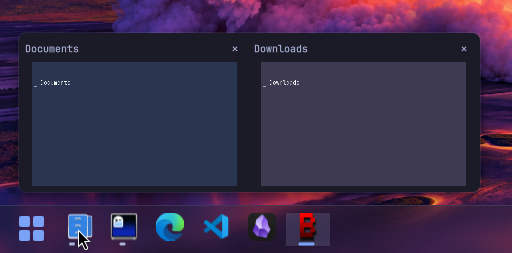

<p align="center">
  <picture>
    
  </picture>
</p>

<h1 align="center">StartBar</h1>

<p align="center">
  <b>A taskbar with a Start menu for Omarchy.</b><br>
  Every open window on every workspace and monitor, your pinned apps, and a Start menu
  with search, all a click away.
</p>

<p align="center">
  <a href="#install">Install</a> ·
  <a href="#tour">Tour</a> ·
  <a href="#configure">Configure</a> ·
  <a href="#commands">Commands</a> ·
  <a href="#update-and-remove">Update and remove</a> ·
  <a href="#contributing">Contributing</a>
</p>

> **Omarchy 4.5:** StartBar is compatible with the windowed mode coming in Omarchy 4.5.

## Install

```sh
omarchy plugin add https://github.com/bmaltais/StartBar --enable
```

It shows a taskbar along the bottom of every monitor, or any other edge you choose (top, left or right). Everything it needs comes with Omarchy; there is nothing else to install. The Start button opens StartBar's own Start menu. To open the Omarchy menu instead, right-click the bar, open **Start button** and choose **Open the Omarchy menu**.

## Tour

### The taskbar


- **Every window.** One icon per open window, across all workspaces and monitors. Click to jump to it.
- **Pins.** Keep apps in the bar whether or not they are running. Drag to reorder, drag out to unpin.
- **Grouped windows.** Optionally stack an app's windows into one icon and pick the window from the previews, as on Windows.
- **Any edge.** Put the bar at the bottom (the default), top, left or right of the screen. On the left and right it is a column, with the running dots beside the icons, above them on the top bar and below them on the bottom one. Menus and previews open on the side facing into the screen, the same distance from the bar as the Start menu is from the edge, as on Windows 11. Choose **Position** in the right-click menu or the settings window.
- **Extras.** Auto-hide, a clock, a workspace badge over each icon, a transparent bar, an option to reserve the bar's space so maximized windows stop at it, and an option to open each new window on a workspace of its own.

### The Start menu


Search every installed app, a Pinned grid you can reorder, an A-Z list, recently launched apps, your folders, and lock, sign out and power. Bind a key to toggle it, then type to search, use the arrow keys to move and Enter to launch. Escape backs out one step at a time.

### Hover previews



Live window thumbnails with a close button. Hovering one shows that window, even from behind a maximized one, and moving away puts things back.

### Colours

<table>
  <tr>
    <th>Light</th>
    <th>Dark</th>
  </tr>
  <tr valign="top">
    <td></td>
    <td></td>
  </tr>
</table>

Colours and fonts follow the current Omarchy theme live, or pick a fixed light or dark bar.

### Right-click an icon

Each icon has its own menu. A pin with no windows offers the app's actions, the app itself and **Unpin from taskbar**; a running app adds its window actions (Maximize, Full screen, Float, Move to scratchpad), then the app and **Pin to taskbar**, and ends with **Close window** (**Close all windows** for a stack of several). With **Snap layouts** on in the settings (Windows page), the menu of a window, on its icon or its preview, starts with layouts (halves, two stacked, thirds, quarters, a main pane with two beside it, one on top with two below it); click a zone to put the window there (a tiled window is floated first). It also adds **Move left / right / up / down** to a tiled window's menu.


## Configure

Changes apply as you make them. There are two ways in.

### Right-click the bar

The common options, kept short: icon alignment, position (bottom, top, left or right), colours, the Start button and window previews open a submenu beside them, and the everyday toggles (auto-hide, clock, group windows, workspace badge, transparent background) sit below. Options that mean nothing while another is off are dimmed. The last row, **Settings…**, opens the full window.


### The settings window

A control for every option, laid out like the Windows 11 settings: a search box at the top, the pages down the left (Taskbar, Windows, Start menu) and the chosen page on the right. Drag the title bar to move it. Options that follow another one are indented and dimmed while it is off.


Type in the search box to find a setting on any page: every word must appear in a setting's name or description, or in its page's name.

### shell.json

Everything is saved in StartBar's own entry in `~/.config/omarchy/shell.json`, which you can also edit by hand:

```json
{
  "plugins": [
    {
      "id": "io.github.bmaltais.startbar",
      "alignment": "center",
      "position": "left",
      "startCommand": "builtin"
    }
  ]
}
```

Every key, its default, and how pinning and dragging behave are in [docs/SETTINGS.md](docs/SETTINGS.md).

## Commands

Run these with `omarchy-shell io.github.bmaltais.startbar <command>`, for instance from a key binding:

| Command | Does |
|---|---|
| `startMenu` | Toggles the Start menu on the focused monitor |
| `closeStartMenu` | Closes it |
| `settings` | Opens the settings window on the focused monitor |
| `closeSettings` | Closes it |

## Update and remove

```sh
omarchy plugin update io.github.bmaltais.startbar --yes && omarchy restart shell
```

Your settings and pins are kept, since they live in `shell.json` and not in the plugin folder. See the [releases page](https://github.com/bmaltais/StartBar/releases) for what changed.

```sh
omarchy plugin remove io.github.bmaltais.startbar
```

## Contributing

See [CONTRIBUTING.md](CONTRIBUTING.md) for the development install, the tests and the manual checklist, [docs/testing.md](docs/testing.md) for the test session that runs the plugin in a second desktop your mouse and keyboard cannot reach, and [docs/recording-tours.md](docs/recording-tours.md) for how the animations above are recorded.

## License

MIT
